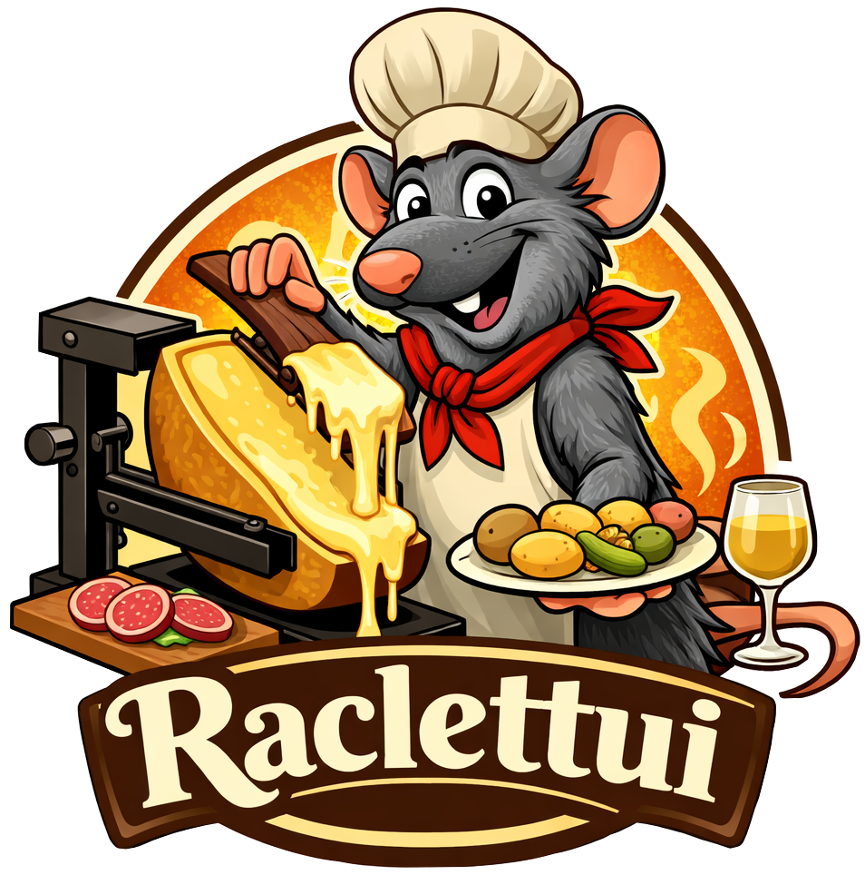

<p align="center">
  
</p>

<div align="center">

[](https://crates.io/crates/raclettui)
[](https://docs.rs/raclettui)
[](https://github.com/ishrut/raclettui)

</div>

# Raclettui

Build TUI (terminal user interface) windows on Wayland via the
layer-shell protocol. Powered by [Ratatui] and [beamterm-core].

## About

Raclettui creates `zwlr_layer_shell_v1` windows (overlays, panels, bars,
lock screens) and implements the Ratatui `Backend` trait so you can draw
terminal-style UIs with GPU-accelerated glyph rendering.

This project is still under active development — expect bugs and breaking
changes. It was developed to build a UI for the author's personal project
when no existing Rust layer-shell libraries fit their needs.

## Requirements

- A Wayland compositor that supports the
  [`zwlr_layer_shell_v1`](https://wayland.app/protocols/wlr-layer-shell-unstable-v1)
  protocol (e.g. Sway, Hyprland, River)
- OpenGL 3.3+ / EGL
- `fontconfig` (for monospace font discovery)

## Usage

Add the dependency:

```sh
cargo add raclettui
```

Minimal example:

```rust no_run
use raclettui::{
    WindowBuilder, KeyCode, WindowEvent,
    layer_shell::KeyboardInteractivity,
};
use ratatui::{Terminal, widgets::Paragraph};

fn main() {
    let window = WindowBuilder::default()
        .set_keyboard_interactivity(KeyboardInteractivity::OnDemand)
        .build()
        .expect("failed to create window");

    let events = window.events();
    let mut terminal = Terminal::new(window).unwrap();

    loop {
        terminal
            .draw(|f| {
                f.render_widget(Paragraph::new("Hello 👋"), f.area());
            })
            .unwrap();

        for ev in events.drain() {
            if let WindowEvent::Keyboard(k) = ev {
                if matches!(k.code, KeyCode::Esc | KeyCode::Char('q')) {
                    return;
                }
            }
        }
    }
}
```

See [examples/hello.rs](examples/hello.rs) for a more complete example.

## Documentation

Full API documentation: <https://docs.rs/raclettui>

## Contributing

Pull requests are welcome! See the [todo list](./TODO.md).

## AI Disclaimer
AI was used to generate documentation and some snippets. However, this is not vibe coded.

## License

Licensed under either of

- Apache License, Version 2.0 ([LICENSE-APACHE](LICENSE-APACHE))
- MIT license ([LICENSE-MIT](LICENSE-MIT))

at your option.

[Ratatui]: https://ratatui.rs
[beamterm-core]: https://github.com/junkdog/beamterm
